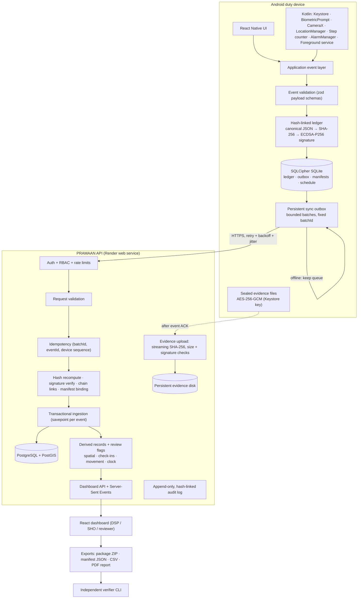
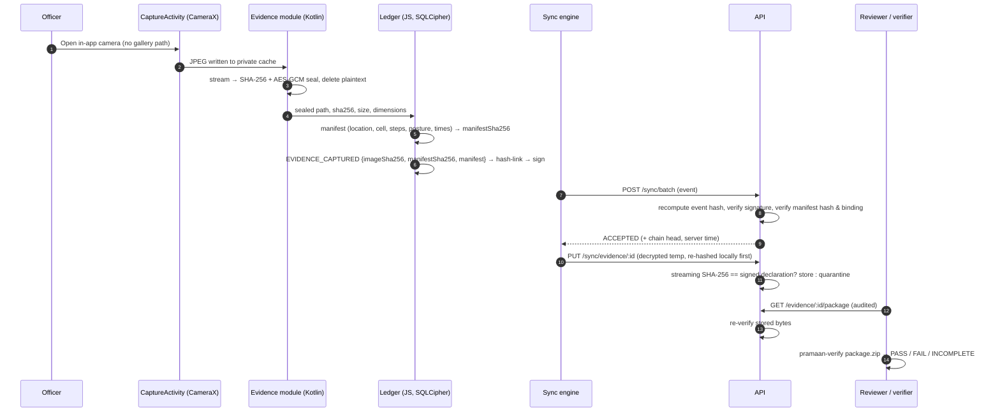
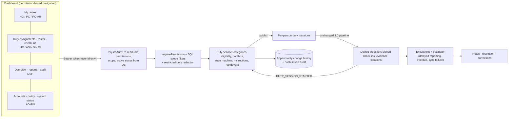

# Architecture

PRAMAAN is an **academic prototype** of an offline-first duty-accountability platform. It combines
independent observations (check-ins, device-held signatures, location, steps, controlled camera
captures, clock behaviour) with cryptographic integrity and **human review**. No single observation
is treated as proof of presence or misconduct.

## Components

| Component | Path | Technology | Responsibility |
|---|---|---|---|
| Duty app (Android) | `apps/mobile` | React Native 0.87 (CLI) + Kotlin | Check-ins, biometric gate, in-app camera, sensors, encrypted ledger, sync |
| Native modules | `apps/mobile/android/app/src/main/java/com/pramaan/mobile` | Kotlin, CameraX, BiometricPrompt, Keystore | Keys, signing, sealing, foreground service, alarms |
| API | `apps/api` | Node 22, Express 5, `pg` | Auth, permission/scope enforcement, duty operations (2.0), idempotent ingestion, verification, PostGIS, reports/exports, SSE |
| Database | `database/` | PostgreSQL 16 + PostGIS 3.4 | Original observations (append-only), derived records, audit chain |
| Dashboard | `apps/admin` | React 19, Vite, Tailwind, React-Leaflet | Permission-based views for every rank: duties, roster, personnel, check-ins, exceptions, evidence, reports, administration |
| Shared contracts | `packages/event-contracts` | TypeScript | Canonical JSON, hashing, chain, clock, movement rules, screen-risk |
| Validation | `packages/validation` | zod | Envelope, payload and manifest schemas |
| Verifier | `packages/verifier` | TypeScript CLI | Offline verification of exported evidence packages |

## Logical architecture

## Evidence lifecycle (capture → independent verification)

## Trust boundaries

1. **Device ↔ user.** The officer controls the phone. Root, instrumentation or a modified build can
   fabricate sensor values and still sign them. Integrity checks prove *consistency since signing*,
   not truth.
2. **Device ↔ network.** TLS in production; release builds reject cleartext (network security config).
3. **API ↔ database.** Original observations are append-only (triggers); a database owner can
   bypass triggers, which the audit hash chain and external checkpoints make detectable.
4. **Dashboard ↔ API.** Short-lived bearer tokens in memory; refresh cookie httpOnly; RBAC on every
   route; image content restricted to SUPERVISOR/ADMIN.

## Implementation status

| Area | Status |
|---|---|
| Shared contracts, validation, verifier | Implemented and Verified (automated tests) |
| API, PostGIS schema, ingestion, evidence verification, exports, audit chain | Implemented and Verified (integration tests against PostgreSQL 16 + PostGIS 3.4, end-to-end simulation) |
| Dashboard | Implemented and Verified (component tests, production build, real screenshots against the running API) |
| Mobile JS logic (ledger, sync, check-ins, evidence pipeline, retention) | Implemented and Verified (unit tests over the real SQL schema on SQLite; Metro release bundle builds) |
| Kotlin native modules | Implemented but Not Verified (not compiled against the Android SDK here; 7 pure-JVM tests of crypto/posture logic pass) |
| Physical-device behaviour (biometric, camera, Keystore, sensors, foreground service, SQLCipher at runtime) | Implemented but Not Verified — requires a physical Android device (see `docs/device-test-checklist.md`) |
| Render deployment | Configuration provided; **not deployed** (no credentials) |

## PRAMAAN 2.0 operations layer

The duty layer does not replace the evidence engine. Every assigned person gets an individual 1.0 duty
session, so signed device events keep flowing through the same verified ingestion path, now linked back to
the operational duty. See `railway-operations.md` and `authorization.md`.
