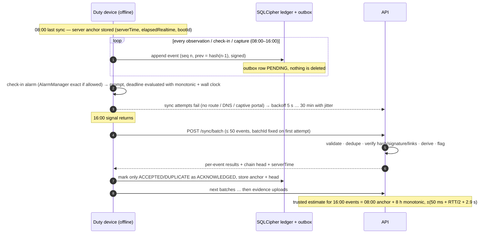

# Data flow, offline operation and time

## Four different times — never conflated

| Field | Source | Trust | Stored where |
|---|---|---|---|
| `deviceWallTime` | `System.currentTimeMillis()` on the phone | **Untrusted** (user-adjustable) | in the signed event, `device_events.device_wall_time` |
| `trustedTimeEstimate` ± `trustedTimeUncertaintyMs` | last server anchor + monotonic elapsed time (same boot only) | Estimate, bounded uncertainty | signed event |
| `server_received_at` | API clock when the HTTP request arrived | Server-trusted | `device_events`, `patrol_logs` |
| `server_processed_at` | DB clock when the row was committed | Server-trusted | `device_events` |

Original device times are never overwritten by later synchronisation.

## What happens during eight hours without signal

1. The app keeps working normally: events are validated, hashed, signed and stored in SQLCipher.
   Uncertainty of the trusted-time estimate grows (100 ppm ⇒ ≈ 2.9 s after 8 h).
2. A reboot during the period makes the anchor unusable; later events carry
   `trustedTimeSource = DEVICE_WALL_CLOCK_UNANCHORED` and a `DEVICE_REBOOTED` anomaly is recorded.
3. Missed check-ins are detected locally (`CHECKIN_MISSED`, reason `NO_RESPONSE`,
   `APP_NOT_RUNNING` or `DEVICE_REBOOTED`) and synchronised later. A late response is a separate
   `CHECKIN_ACKNOWLEDGED_LATE` event; the missed record is never rewritten.
4. On reconnection batches are replayed with their original `batchId`; a lost response simply yields
   the stored response on the next attempt (verified in `sync.test.ts` and the demo run).
5. The dashboard shows these observations as **Delayed synchronization** (recorded long before
   receipt), never as live positions.

## Stage-by-stage data flow

| Stage | Where | Mechanism |
|---|---|---|
| Evidence creation | `CaptureActivity.kt` | CameraX ImageCapture to private cache; NIGHT extension or auto flash for low light |
| Local persistence | `PramaanEvidenceModule.seal`, `LedgerService.append` | AES-GCM sealed file; one SQLCipher transaction for event + outbox + manifest |
| Cryptographic signing | `KeystoreManager.signWithDeviceKey` | ECDSA P-256 over `PRAMAAN-EVENT-V1:<hash>` |
| Queueing | `sync_outbox` | `PENDING → ASSIGNED(batchId) → ACKNOWLEDGED / REJECTED` |
| Network reconnection | `SyncEngine.runOnce` | NetInfo + real request; non-JSON (captive portal) and 5xx are failures |
| Server-side verification | `ingest.ts`, `upload.ts` | schema → hash → signature → manifest → links → duty window |
| Spatial analysis | `spatial/zones.ts` | `ST_Covers` / `ST_Distance` on `geography`, accuracy allowance |
| Supervisor review | dashboard Alerts / Evidence / Map | acknowledge, assign, resolve (note required); all audited |
| Retention and audit | `retention_policies`, `compactLedger`, `audit_events` | append-only, hash-linked, exported checkpoints |
