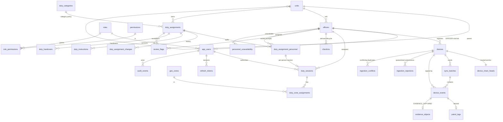

# Database design

PostgreSQL 16 + PostGIS 3.4. Migrations: `database/migrations/0001…0007` (forward-only, checksummed,
see ADR-005). 0006–0007 were added in PRAMAAN 2.0 for the railway-police operations modules and are
upgrade-safe for an existing 1.0 database (tested). All server timestamps are `timestamptz`. Geometry uses `geography(…, 4326)`; points are
built as `ST_MakePoint(longitude, latitude)` — **longitude first**.

## Entity relationships

## Tables

| Table | Kind | Key constraints |
|---|---|---|
| `officers` | identity (pseudonymous `employee_ref`) | unique ref, rank check, `is_demo` |
| `app_users` | dashboard/mobile accounts | unique lower-case e-mail; OFFICER ⇔ `officer_id` set; Argon2id hash |
| `refresh_tokens` | sessions | only SHA-256 of token stored; family id for reuse detection |
| `devices` | registered keys | SPKI public key, unique SHA-256 fingerprint, `PENDING/ACTIVE/REVOKED` with consistency checks |
| `device_chain_heads` | trusted anchor | last verified (sequence, hash) per device |
| `geo_zones` | spatial | `geography(MultiPolygon,4326)`, GiST index, `ST_IsValid` check, version + validity period |
| `duty_sessions`, `duty_zone_assignments` | assignment | planned window ≤ 16 h, authorising supervisor |
| `sync_batches` | idempotency | `batch_id` PK + request SHA-256 + stored response |
| `device_events` | **original observations, append-only** | PK event id, unique `(device_id, sequence)`, unique hash, full signed envelope, triggers block UPDATE/DELETE/TRUNCATE |
| `ingestion_rejections`, `ingestion_conflicts` | quarantine, append-only | submitted content + SHA-256 preserved |
| `patrol_logs` | derived | `geography(Point,4326)` GiST, spatial result, matched zones |
| `evidence_objects` | derived verification state | declared hashes immutable (trigger); `VERIFIED ⇒ computed = declared` check |
| `checkins` | derived check-in lifecycle | status precedence keeps missed + late separately recorded in events |
| `review_flags` | derived prompts | `dedupe_key` unique, `inputs` JSON = evidence that produced the flag |
| `audit_events`, `audit_chain_head` | append-only, hash-linked custody log | gapless sequence, `previous_hash`, `record_hash`, triggers |
| `retention_policies` | governance | retention days per category |
| `schema_migrations` | versioning | version, file name, checksum |

### PRAMAAN 2.0 tables (migrations 0006–0007)

| Table | Kind | Key constraints |
|---|---|---|
| `units` | organisation tree | unique code; `SUBDIVISION/CIRCLE/STATION/OTHER`; optional illustrative `geo_zone_id` |
| `officers` (extended) | personnel profile | `personnel_category` (`POLICE`/`HOME_GUARD`), `rank` (PC…DSP; NULL for HG, enforced), `constable_category` (AR/GENERAL, PC only), `gender` (default NOT_RECORDED), `unit_id`; **DELETE blocked** by trigger |
| `roles`, `permissions`, `role_permissions` | authorisation | role scope level; `requires_personnel`; FK from `app_users.role`; trigger enforces personnel link |
| `duty_categories`, `duty_category_eligibility` | configurable policy | per-category check-in/reporting/grace, restriction, acceptance, min personnel, BLOCK/WARN eligibility, `policy_version` |
| `duty_assignments` | operational duty | unique reference; category-specific references; status check; ≤ 16 h; DELETE blocked |
| `duty_assignment_personnel` | people on a duty | one active row per person per duty (partial unique index); class snapshot; links to the per-person `duty_sessions` row; removal/replacement reason kept; DELETE blocked |
| `duty_assignment_changes` | **append-only** change history | before/after JSON, reason, actor, `clock_timestamp()`, `seq` ordering |
| `duty_instructions`, `duty_instruction_acks` | versioned instructions | `(assignment, version)` unique; body SHA-256; append-only |
| `duty_handovers` | handovers | outgoing ≠ incoming; per-side acknowledgement times |
| `personnel_unavailability` | availability | generic categories; cancellation kept |
| `notifications` | in-app inbox | `QUEUED/DELIVERED/READ` with timestamps; dedupe key |
| `record_corrections` | audited corrections | server-read original + proposed value; requester ≠ decider (check); immutable once decided (trigger) |
| `review_flags` (extended), `review_flag_notes` | exceptions | new operational flag types; `duty_assignment_id`; append-only investigation notes |
| `duty_sessions` (extended) | per-person session | `server_started_received_at` stored beside the device-reported start |

### Legacy data mapping in migration 0006
Existing ranks are mapped `CONSTABLE → PC` (subtype left unrecorded), `HEAD_CONSTABLE → HC`, `INSPECTOR → CI`;
`ASI`, `SI`, `DSP` and `OTHER` are unchanged. Existing accounts keep their roles (`ADMIN`, `SUPERVISOR`,
`REVIEWER`, `OFFICER`), and those roles get permission sets equivalent to PRAMAAN 1.0 behaviour. Devices, events,
evidence, flags and the audit chain are not modified. The test `migration-upgrade.test.ts` applies 0001–0005,
inserts legacy records, upgrades, and checks the mapping, the audit chain and legacy logins. A real upgrade of
the local 1.0 demo database was also run (`pnpm db:migrate` applied 0006–0007; `pnpm db:verify-audit` reported
`ok`).

## Original vs derived data
Resolving a flag updates only `review_flags` (and writes an audit record). The `device_events` row —
including the exact signed envelope — is never modified. This is enforced by a trigger and covered by
the test *"requires notes to resolve … and never alters the observation"*.

## Spatial semantics
`evaluateLocation` (apps/api/src/spatial/zones.ts):
- `INSIDE_ASSIGNED_ZONE` — `ST_Covers(zone, point)` for an assigned zone;
- `OUTSIDE_WITHIN_ACCURACY` — outside, but distance ≤ reported horizontal accuracy + 5 m boundary tolerance;
- `OUTSIDE_ASSIGNED_ZONE` — beyond that allowance (raises a LOW review flag, at most one per duty-hour);
- `NO_ASSIGNED_ZONE`, `NO_LOCATION`.
GPS accuracy (a statistical radius reported by the phone) and polygon precision (the demo polygons are
illustrative rectangles, not surveyed boundaries) are both uncertainties; neither turns a point just
outside a polygon into proof of anything. Zones are evaluated at the **observation time**, so delayed
offline observations use the zone version valid at that time.

## Backup and restore
`scripts/backup-restore-check.sh` performs `pg_dump -Fc` → restore into a new empty database → compares
row counts of the key tables → checks that every `storage_ref` exists in the evidence directory →
re-verifies the audit hash chain on the restored copy. The run recorded in
`docs/results/backup-restore-check.txt` passed (re-run for PRAMAAN 2.0 including the new tables). The script
also writes `backup-verification.json` (passed/failed, time, dump SHA-256). The protected status page shows
that file when `BACKUP_VERIFICATION_FILE` points to it, and only then. Evidence bytes live on disk and must be backed up
separately (Render disk snapshots or file-level copies).
