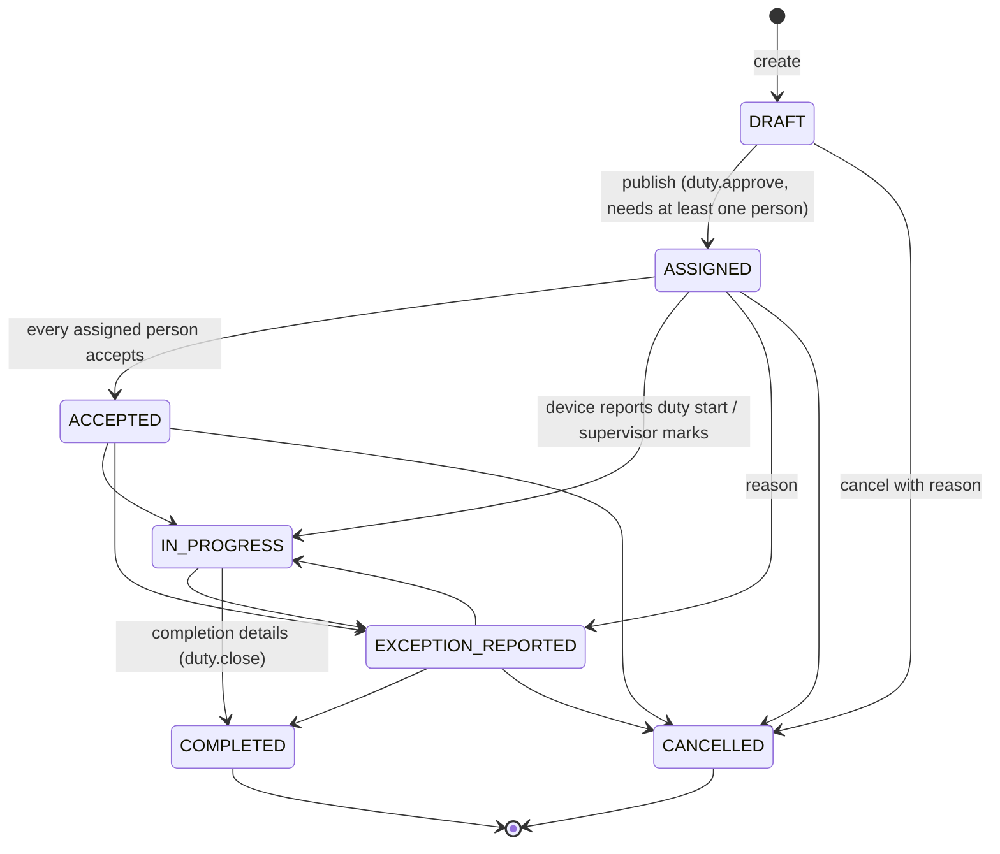

# Railway-police operational workflow (PRAMAAN 2.0)

PRAMAAN 2.0 adds a duty-assignment, supervision and reporting layer on top of the PRAMAAN 1.0
proof-of-presence engine (signed offline ledger, check-ins, in-app evidence, PostGIS checks, audit chain).
The operational information came from a conversation with an Assistant Superintendent of Police. Where a rule
was not stated, the prototype uses a **configurable default and marks it for departmental confirmation**.
No Andhra Pradesh Railway Police regulation has been invented or encoded as fact.

## 1. Personnel and hierarchy

Supplied hierarchy: **HG** (Home Guard), **PC** (Police Constable), **HC** (Head Constable), **ASI**,
**SI**, **CI**, **DSP**. HG is a separate personnel category outside the police rank hierarchy. A PC may be
classified as **AR** (Armed Reserve) or **General**. This is a constable attribute, not an additional rank.
Details, the default permission sets and the data scopes are in [`authorization.md`](authorization.md).

The **Personnel** module provides search and filters (name, personnel ID, rank/category/subtype, status, unit),
detail pages (profile, linked account, duty history, check-ins, unavailability, exceptions and administrative
audit history), and authorised create, edit, activate and deactivate actions. Personnel IDs are unique.
Personnel rows **cannot be deleted** (database trigger), so duty, check-in and evidence history is never
destroyed. Deactivation also deactivates the linked login account, revokes its sessions and raises an
`INACTIVE_PERSONNEL_ASSIGNED` exception for each duty the person is still assigned to.

## 2. The four duty categories

| Category | Purpose | Reference recorded | Restricted by default |
|---|---|---|---|
| **Train Beat** | Accompany or patrol a train according to the duty plan | Train / service reference (optional, synthetic in demos) | No |
| **Station Watch** | Watch or patrol a railway station; multiple shifts and handovers | Station (required) | No |
| **VIP Escort** | Escort or protection duty with minimum operational data | Escort label (required; **synthetic labels only**) | Yes |
| **Track Incident** | Response to track accidents or reports of deceased persons | Incident reference (required; **fictional only**) | Yes |

The demonstration data contains no real train schedules, VIP itineraries, contact details, incident or
case numbers, victim identities or images. Incident evidence in the demo is a synthetic, non-graphic
generated image.

### Staffing rules (configurable, not hard-coded)
* **No fixed combination is required.** A duty may have one person, two AR constables, two General
  constables, any mix, HGs with or without constables, or supervisory officers. Tests exercise all of these.
* **Eligibility per category** lists the personnel classes allowed on that category
  (`duty_category_eligibility`). By default HG, PC (AR, General, or subtype not recorded), HC, ASI and SI are
  eligible for all four categories, and CI also for VIP escort. The source said HGs are used *primarily*
  for train beats and station watches but *may* be assigned to escort and incident duties, so they are
  eligible everywhere by default.
* **Eligibility mode** per category: `BLOCK` (reject an ineligible person with `NOT_ELIGIBLE`) or `WARN`
  (allow, with a warning).
* **Warnings, not rejections,** for staffing gaps: fewer personnel than the configured minimum, no
  supervising officer where one is expected (VIP escort and track incident by default), no instructions
  published, acceptance still pending, or inactive or ineligible members.
* **Hard rules:** inactive personnel cannot be *newly* assigned. A person cannot be on the same duty twice.
  Overlapping duties and recorded unavailability return `409 ASSIGNMENT_CONFLICT` with the list of conflicts.
  A user holding `duty.approve` can override with a reason. The override is stored on the assignment row and
  raises an `ASSIGNMENT_CONFLICT` exception for review.

### Check-in policy per category
Each category has its own random check-in interval (minimum to maximum), response window, reporting window,
grace period and maximum duration (prototype defaults: train beat 60–120 min, station watch 90–150 min, VIP
escort 45–90 min, track incident 60–120 min). The policy is versioned. Every per-person session delivered to
the Android app includes it, and the app schedules check-ins inside that category's window instead of a
single global schedule. The 5-second cognitive challenge after the biometric prompt is unchanged.

## 3. Assignment life cycle

Any other transition is rejected with `409 INVALID_TRANSITION`. Who may perform each transition: publishing
needs `duty.approve`; completing, cancelling and manually marking a duty in progress need `duty.close`;
reporting an exception needs `duty.close` or being one of the assigned personnel. Every transition, personnel
change, schedule or detail change, instruction version and handover is written to the append-only
`duty_assignment_changes` table (before value, after value, reason, actor, time) and to the hash-linked audit
log.

**An assignment is not proof of attendance.** `IN_PROGRESS` is set automatically when an assigned person's
device synchronises a signed `DUTY_SESSION_STARTED` event. The change history records the reason as
“device-reported time; not proof of physical attendance”. `COMPLETED` is a supervisory record with mandatory
completion details.

### Reassignment, replacement and schedule changes
Removing or replacing a person keeps the original row with status `REMOVED`/`REPLACED`, the reason, the actor
and the time. A replacement links to the new row. A planned device session that never started is
cancelled; an active session is left for the device to end. Schedule changes to a published duty need a
reason, re-check conflicts for everyone assigned, update planned per-person sessions and notify the
personnel.

### Instructions, acceptance and handover
* **Instructions** are versioned and append-only, with a SHA-256 of the text. Each published version is
  acknowledged separately by assigned personnel (`duty_instruction_acks`). Earlier versions remain visible as
  superseded.
* **Acceptance** (enabled per category; on for VIP escort by default): each assigned person accepts. When
  nobody is still pending, the duty moves to `ACCEPTED`.
* **Handover** records the outgoing person, the incoming person, the handover time and outstanding tasks. Both
  people acknowledge it. The outgoing person can record their own handover; recording one for others needs
  `duty.handover.record`. If either person is not listed on the duty, a warning is returned.

### Unavailability and roster
Unavailability periods use generic categories only (leave, training, court attendance, medical, other); no
leave policy is modelled. Recording a period that overlaps an assigned duty raises a conflict exception. The
**Duty roster** shows daily, weekly and monthly grids of personnel × days within scope. It marks duties by
category, drafts (faded), unavailability (hatched) and conflicts (red outline: overlapping duties, or duty
during unavailability).

## 4. Presence verification integration

Every person assigned to a duty receives an individual PRAMAAN 1.0 `duty_session` when the duty is published.
All existing mechanisms therefore apply unchanged: signed and hash-linked device events, biometric plus
cognitive check-ins, in-app camera evidence with SHA-256 verification, PostGIS zone checks (the station's
illustrative zone, if configured), offline ledger and idempotent synchronisation. Each check-in and evidence
item is linked to the person and, through the session, to the duty assignment.

What a supervisor sees for each person: the device-reported start (**device clock**) beside the
**server receipt** time; check-ins acknowledged on time, late or missed; the last device synchronisation; and
for every check-in the location provenance (coordinates, reported accuracy, spatial result, mock-location
indicator, which event supplied it). Evidence states are shown as *Verified (hash matches)*,
*Synchronised · image pending*, *Failed integrity check* (quarantined), or *Incomplete* (upload limit
reached). *Pending on device* can only be shown in the app. GPS alone is never presented as proof of
presence, and evidence integrity is never presented as proof of attendance.

## 5. Exceptions (review flags)

Exception types: missed check-in, late acknowledgement, **delayed reporting** (no device-reported start within
the category's reporting window plus grace, or a start reported after it), **overdue duty** (still open past
planned end plus grace), **synchronisation failure** (active duty with no device sync for 60 minutes),
evidence-hash mismatch, **assignment/leave conflict**, **inactive personnel still assigned**, **duty exception
reported**, and the PRAMAAN 1.0 integrity and spatial flags. A server-side evaluator runs every
`EXCEPTION_EVALUATOR_INTERVAL_SECONDS` (default 60; deduplicated, so repeat runs add nothing) and can be run on
demand from the Exceptions page. Supervisors acknowledge, assign, add **append-only investigation notes**,
resolve or dismiss (a note is required) and reopen. Each action is audited. Exception texts state that they are
prompts for review and not findings of misconduct, and nothing in the system classifies misconduct.

## 6. Audited corrections

Historical attendance, check-in and evidence metadata are never overwritten. A correction request
(`record_corrections`) stores the **original value as read by the server**, the proposed value, the reason and
the requester. A different user holding `correction.approve`, within scope, approves or rejects it with a note.
Decided corrections are immutable (trigger). Views show an approved correction beside the original (for example
“Approved correction: … (original kept)”). Correctable fields: check-in status and missed reason; reported start
and attendance note of an assigned person; evidence capture device time.

## 7. Notifications

In-app notifications are created for assignment, publication, changes, removal, cancellation, new instruction
versions, handovers, exceptions (to the duty's creator and supervising officer) and correction decisions. The
delivery state is truthful: `QUEUED` when created, `DELIVERED` only when the recipient's signed-in app
retrieves it, `READ` when opened. There is no push or SMS channel, so the prototype never claims that a
notification reached a phone.

## 8. Dashboards, reports and system health

* **Overview** (for `dashboard.view`): active personnel; counts by rank and subtype; duties by category with
  status mix and completion rate; missed and late check-ins; evidence verification failures; pending and failed
  synchronisation; duties with conflicts; open exceptions by type; recent audit events (if `audit.view`).
  Filters: date range, category, unit. Every figure is a `COUNT` over stored rows within the user's scope. A test
  compares the API figures with direct database counts.
* **My duties** (every account linked to a person): upcoming and current duties, accept and acknowledge
  actions, the server's view of the user's device synchronisation, check-in and evidence counts, handovers.
* **Reports** (CSV and PDF): roster, assignments, duty completion, exceptions, evidence verification. Scoped,
  restricted details redacted, and each export audited with its SHA-256 (`REPORT_EXPORTED`).
* **System status** (`system.health`): API uptime; database latency, versions, migrations and pool; an evidence
  storage write/read probe and free space; synchronisation counters; full audit-chain verification; and
  **backup status only when** a result file written by `scripts/backup-restore-check.sh` exists
  (`BACKUP_VERIFICATION_FILE`). Otherwise it shows “not available”.

## 9. Localisation

The new screens read their labels from `apps/admin/src/i18n/en.ts` through `t()` and `tCode()`. A Telugu
dictionary file (`te.ts`) exists and falls back to English per key. It is intentionally empty: translations
should be prepared by a fluent reviewer using the department's terminology, not generated. Some PRAMAAN 1.0
pages still contain inline English strings (see limitations).

## 10. Synthetic demonstration data

`pnpm db:reset-demo` (or `pnpm db:seed -- --reset --reference-date YYYY-MM-DD`) creates, deterministically
for a given reference date:
* a fictional unit tree: a DEMO sub-division, two circles and three station units (Guntur, Tenali,
  Narasaraopet). Only the Guntur unit is linked to an illustrative zone polygon;
* 25 synthetic personnel with plausible Telugu-region names (11 female and 14 male, as supplied in the seed):
  5 HG, 5 PC-General, 5 PC-AR, 2 HC, 2 ASI, 2 SI, 2 CI and 1 DSP (24 active), plus 1 inactive PC-General.
  Personnel IDs carry a `DEMO-` prefix;
* the nine `@parmaan.demo` accounts;
* 11 duties across all four categories: completed, in-progress candidates, assigned, accepted, draft and
  cancelled. They include two station-watch shifts with a recorded handover, versioned instructions with
  partial acknowledgement, a restricted VIP escort awaiting acceptance, a restricted track incident, a duty
  in another circle (to show scope boundaries), and two unavailability periods.

All records are flagged `is_demo` and shown with a **DEMO** / **DEMO DATA** badge. None of it comes from real
personnel records, including anything shared in the conversation with the ASP. The PRAMAAN 1.0 demo records
(`*@pramaan.demo`, password = `SEED_DEMO_PASSWORD`) are kept so the original simulated-device demonstration
still works.
