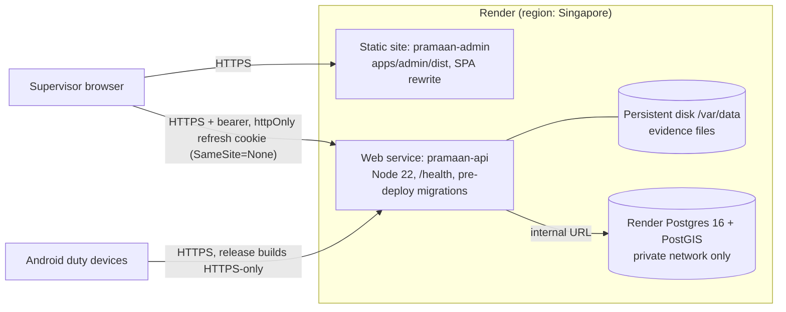

# Deployment design

| Concern | Design |
|---|---|
| Build | pnpm via corepack, frozen lockfile, shared packages compiled first |
| Migrations | pre-deploy `migrate-cli.js` (advisory lock, checksums) or `RUN_MIGRATIONS_ON_START` |
| Secrets | `JWT_ACCESS_SECRET` generated by Render; no secrets in `VITE_*`; production start refuses unsafe config |
| TLS | Render-managed certificates; HSTS; Android release network security config forbids cleartext |
| CORS / cookies | exact dashboard origin; `COOKIE_SAMESITE=none` because `*.onrender.com` is a public suffix; CSRF header |
| Database | private networking (empty IP allow-list), backups per plan, restore drill script |
| Evidence | persistent disk (paid instance type); single instance; object storage = future work |
| Observability | structured JSON logs (redacted) in Render logs; health checks |
| Rollback | Render keeps the previous deploy on build/pre-deploy failure; manual rollback; forward-only migrations |

The exact procedure is in the *Windows and Render Deployment Guide*. **No deployment was performed for
this delivery** (no credentials were available).
