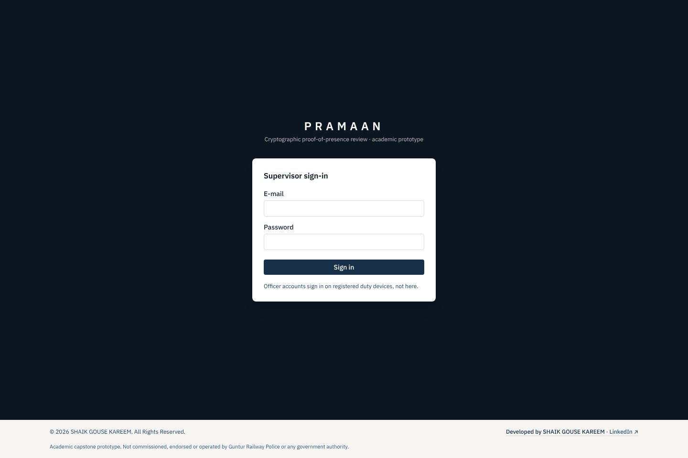
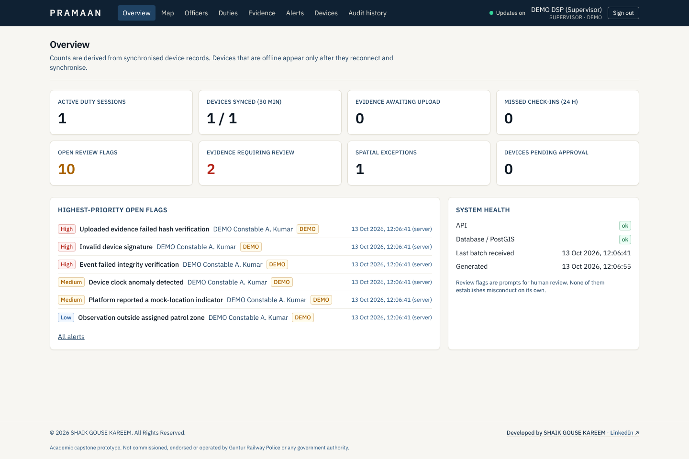
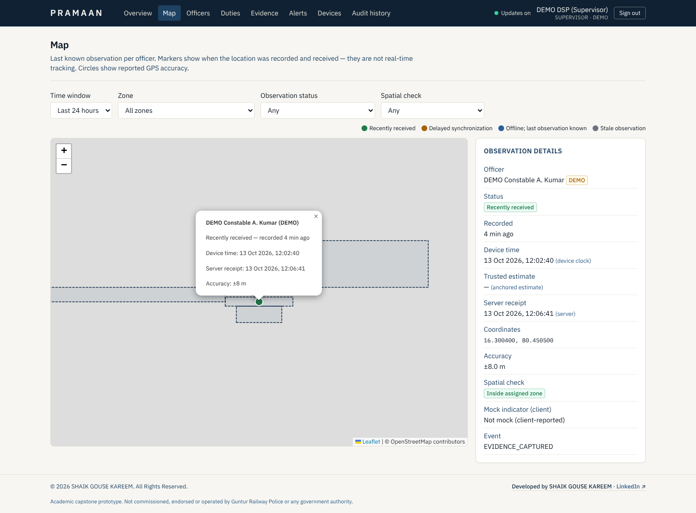
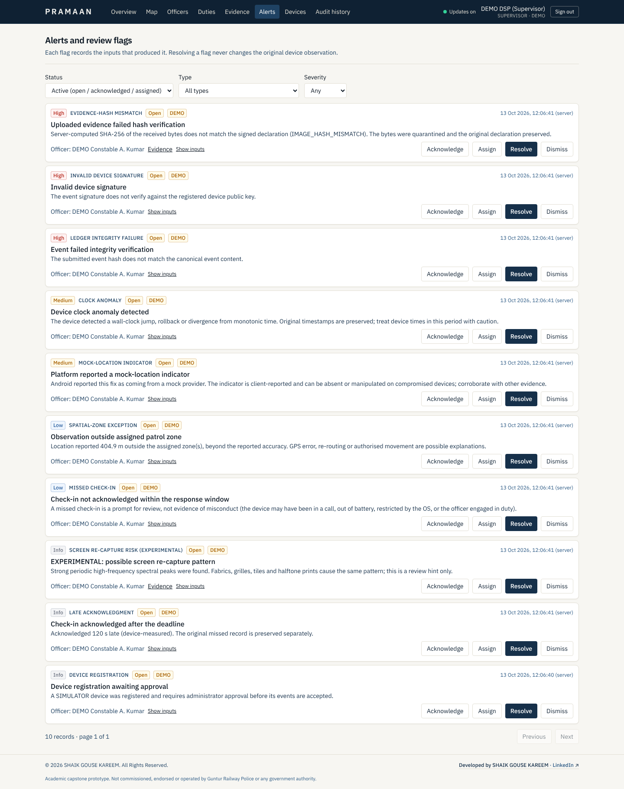
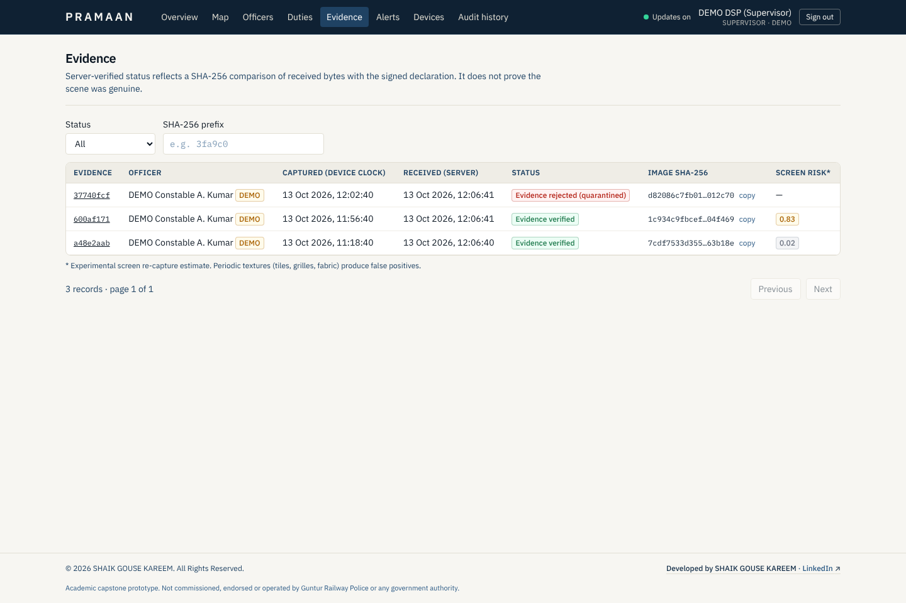
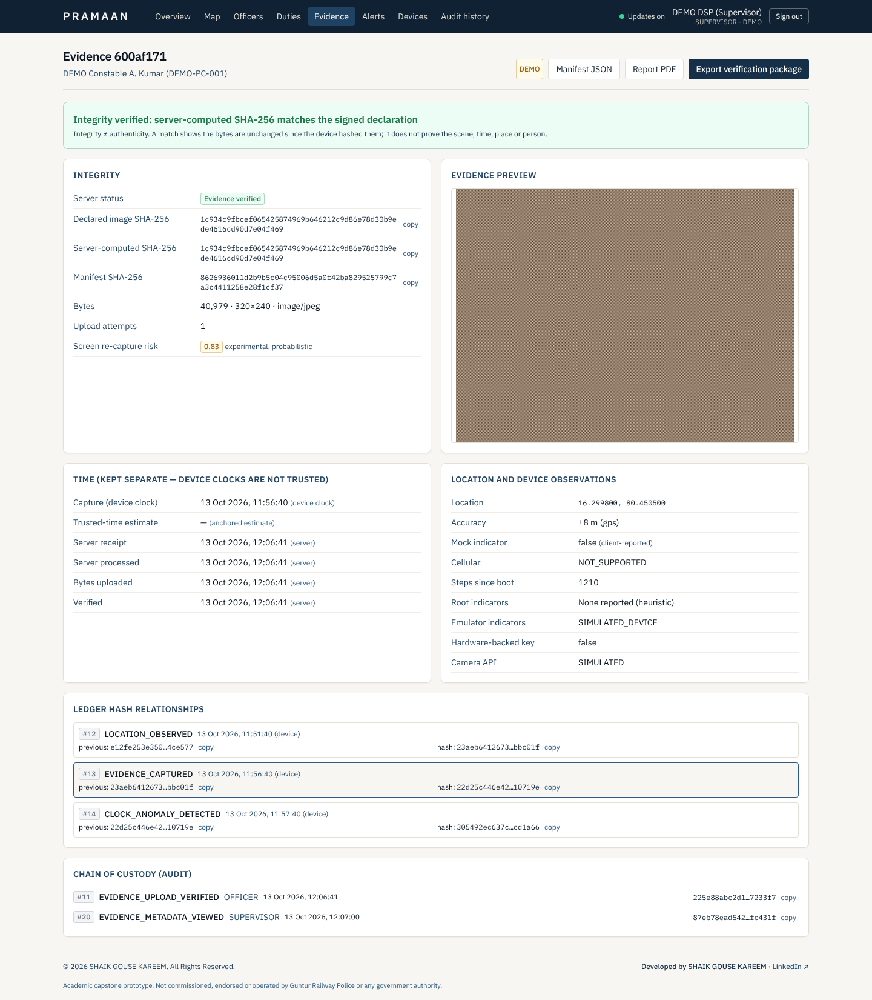
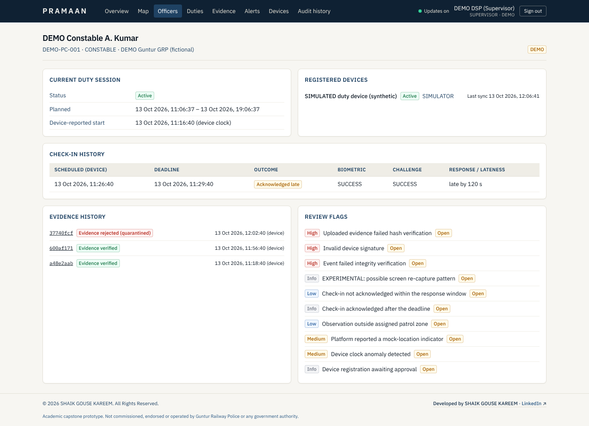
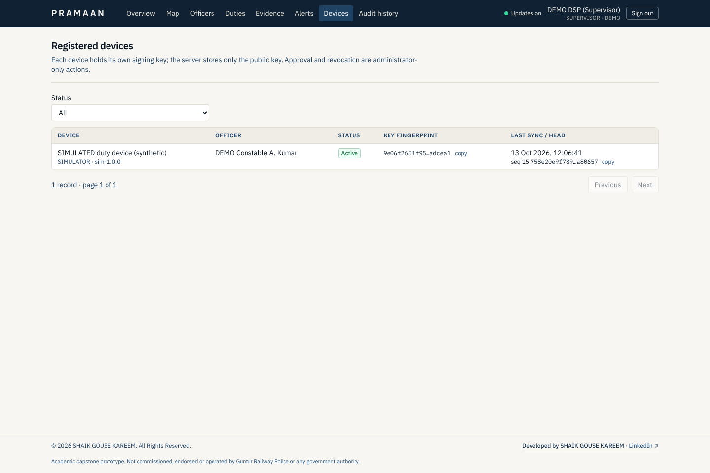
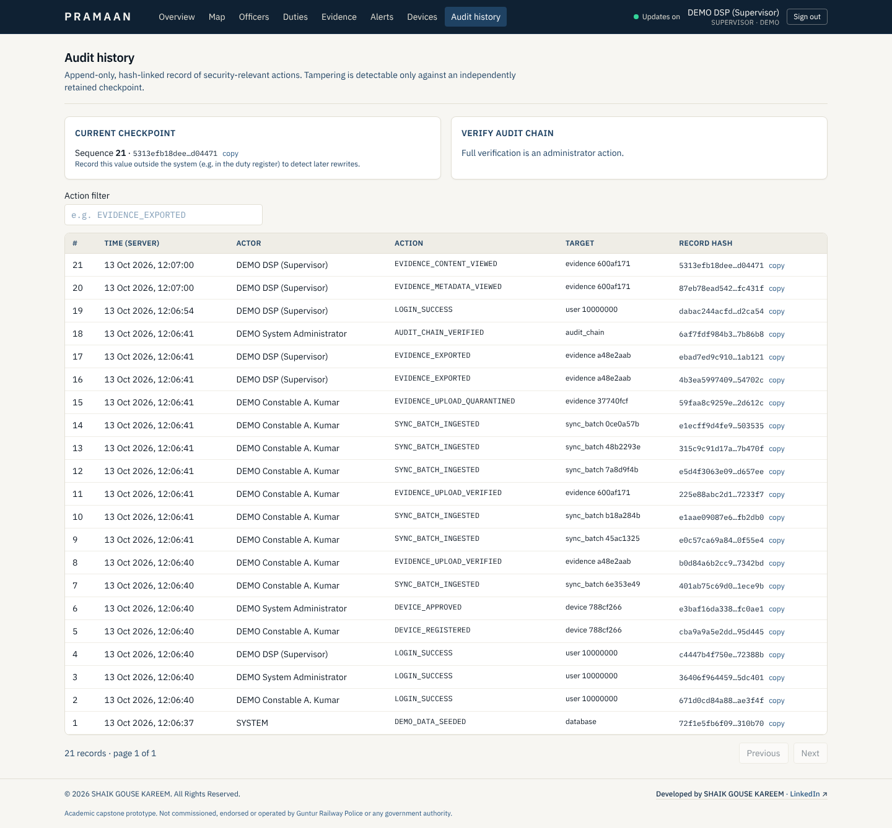
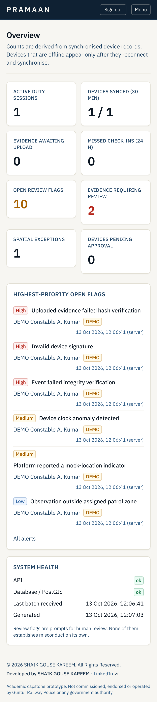

# Dashboard screenshots

Real screenshots captured with Playwright (Chromium) from the production build (`vite build` + `vite preview`)
connected to the running API after the simulated end-to-end demo (`tools/docs/capture_screenshots.py`).
The authoring environment had no internet access, so **OpenStreetMap basemap tiles could not load**; zone
polygons, markers, accuracy circles and labels are rendered from the PRAMAAN API.

